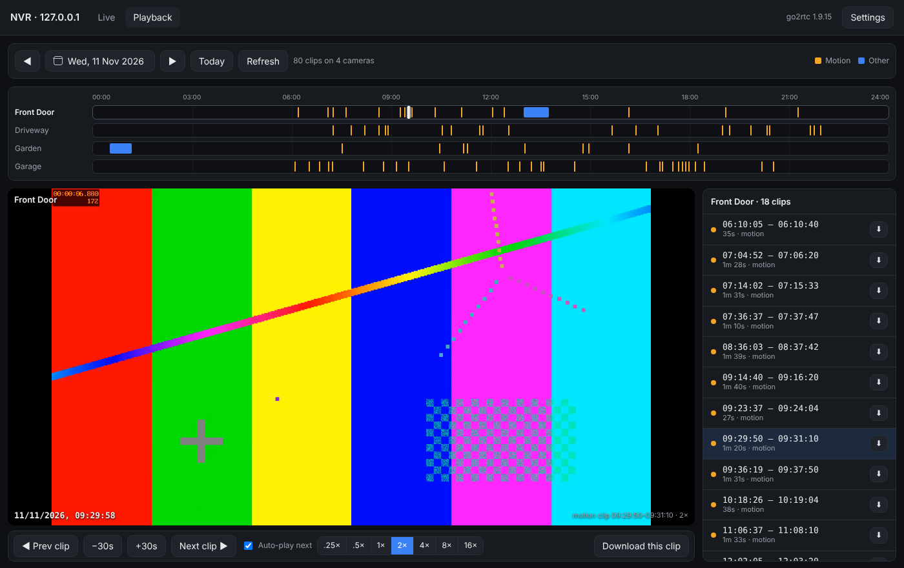
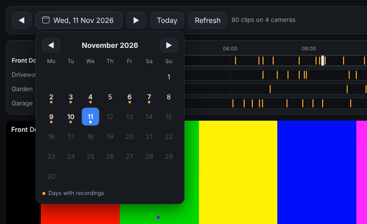

# Hikvision Web Viewer

A plugin-free replacement for the live view and playback pages of older Hikvision NVRs.

Many Hikvision NVRs from around 2016–2019 need a browser plugin for live view and playback. That plugin no longer works in current Chrome, Edge, Safari or Firefox, and on a Mac it never worked in Chrome at all. Newer firmware with plugin-free viewing often isn't available for these models. This project gives you a modern web viewer instead. It runs on a Mac, or on a NAS or server with Docker (including older Synology DSM 6 boxes).





## Features

- **Live view:** a 2×2 grid using the low-bandwidth sub streams. Double-click a camera for full quality.
- **Recording calendar:** dots mark the days with recordings.
- **Clip timeline:** every recorded clip for each camera on the chosen day. Orange is motion, blue is any other type. Click a block, or a clip in the list, to play it.
- **Any-speed playback:** 0.25× to 16×. 8× and 16× show keyframes only, for quick scanning. Clips can auto-play one after another.
- **Fast clip downloads:** MP4 at original quality with no re-encoding, pulled from the NVR at full network speed.
- **Snapshots and recording:** save a JPEG of any frame, or record live video to MP4.
- **H.264 and H.265:** H.265 plays in Safari, and in Chrome or Edge on hardware that supports it.
- **NVR login stays on the server:** browsers never see it. An optional viewer password lets you share the page on your network.

## How it works

```
NVR ──RTSP──▶ go2rtc ──▶ cctv-server ──▶ browser
   └──ISAPI (clip search, calendar, downloads)──▶ cctv-server
```

- **[go2rtc](https://github.com/AlexxIT/go2rtc)** converts the NVR's RTSP video into something browsers can play (fMP4 over WebSocket).
- **cctv-server** (`server/`, Go) serves the page and keeps the NVR login. It turns the page's stream requests into RTSP URLs and blocks every other go2rtc API.
- It also talks to the NVR's ISAPI to find recordings and download clips. Downloads come from the NVR as MPEG-PS; the server converts them to MP4 for download, or paces them at the chosen speed for faster or slower playback.

## Install

Download the latest zip from [Releases](../../releases). It includes the server for macOS (Apple Silicon and Intel) and Linux (x86-64 and ARM64).

### Mac

1. Unzip it somewhere permanent and double-click **Start CCTV Viewer.command**. If macOS blocks it, go to System Settings → Privacy & Security → **Open Anyway**.
2. The first run downloads go2rtc (about 20 MB) and opens http://127.0.0.1:1984/.
3. Enter the NVR address and login under **Settings**.

### Docker / Synology

1. Copy the unzipped folder to the host, e.g. `/volume1/docker/hikvision-web-viewer`.
2. In `docker-compose.yml`, set `VIEWER_PASSWORD`. The viewer won't start while it's still `change-me`. Delete the line to run without a login.
3. Start it:
   - **DSM 7.2+:** Container Manager → Project → Create → choose the folder → *Use existing docker-compose.yml*.
   - **DSM 6 / anything else:** over SSH, `cd` to the folder and run `sudo docker-compose up -d`.
4. Open `http://<host>:8095`, log in as `viewer`, and enter the NVR login under **Settings**. It's saved in `data/settings.json`.

If your firewall is on, allow TCP port 8095.

> **DSM 6 "x509: certificate signed by unknown authority" when pulling images:** DSM 6's list of trusted certificates is too old for Docker Hub. On another machine, run `docker pull` and `docker save alexxit/go2rtc:1.9.15 alpine:3.20 -o images.tar`. Copy `images.tar` to the NAS and run `sudo docker load -i images.tar`, then `docker-compose up -d`.

## Compatibility

Developed against a **DS-7604NI-K1/4P(B)** on firmware **V3.4.100**. It uses standard Hikvision RTSP and ISAPI calls, so most Hikvision NVRs and DVRs (and many HiLook and other rebrands) should work:

| Feature | ISAPI / RTSP used |
|---|---|
| Live view | `rtsp://…/Streaming/Channels/<ch>01` and `…02` |
| Calendar | `POST /ISAPI/ContentMgmt/record/tracks/<id>/dailyDistribution` |
| Clip list | `POST /ISAPI/ContentMgmt/search` |
| Playback at 1× | `rtsp://…/Streaming/tracks/<id>01?starttime=…` |
| Other speeds and downloads | `GET /ISAPI/ContentMgmt/download` |

If the NVR refuses ISAPI downloads, the download button falls back to recording the RTSP playback in real time. Reports of other models that work (or don't) are welcome in Issues.

## Configuration

`cctv-server` reads these environment variables:

| Variable | Default | |
|---|---|---|
| `LISTEN` | `127.0.0.1:1984` | Address to serve on |
| `GO2RTC` | `http://127.0.0.1:1986` | go2rtc API, which should only listen on localhost |
| `WWW_DIR` | `www` | Viewer page |
| `DATA_DIR` | `data` | Where the NVR login is saved |
| `VIEWER_PASSWORD` | *(none)* | If set, viewers must log in as `viewer` |

## Security notes

- go2rtc listens on `127.0.0.1` only. cctv-server passes through only the stream endpoints, and only for `nvr:` stream names it builds itself, so the page can't open arbitrary URLs.
- The NVR login is stored in `data/settings.json` with `0600` permissions and never sent to browsers.
- There's no HTTPS. Use it on your local network, or put it behind a reverse proxy or VPN. Don't expose it directly to the internet.

## Building

Needs Go 1.26+.

```
scripts/build.sh v1.0.0      # binaries in bin/, ready-to-run zip in dist/
cd server && go test ./...
```

## Licence

Copyright © 2026 Project X Creative.

This program is free software, released under the [GNU General Public License v3.0](LICENSE) or (at your option) any later version.

Video relay by [go2rtc](https://github.com/AlexxIT/go2rtc) (MIT). Not affiliated with or endorsed by Hikvision.
